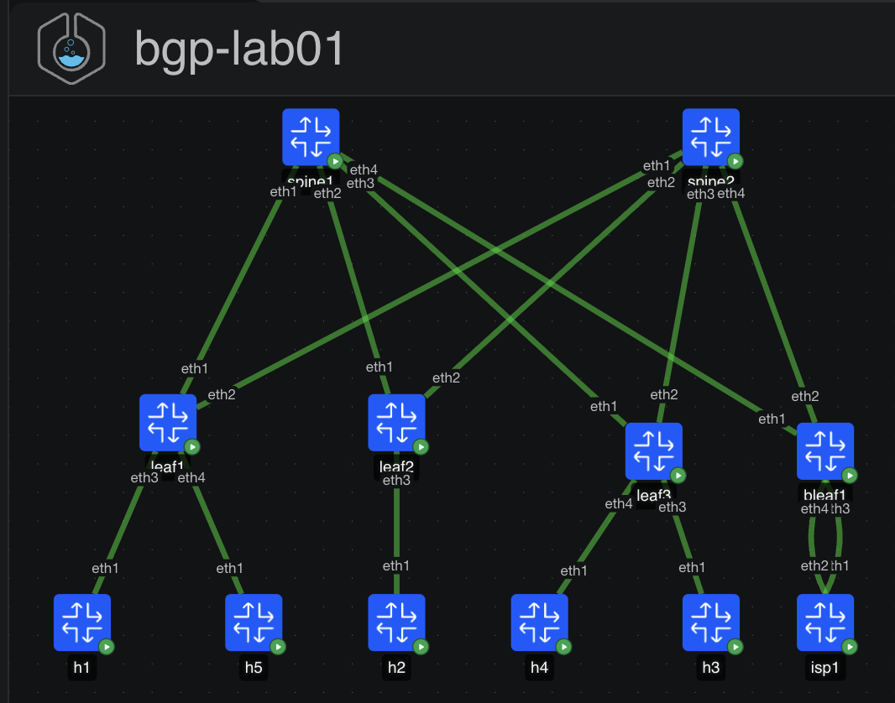

# BGP Lab 01: Multi-Tenant EVPN-VXLAN Fabric with a Fusion Edge

**Level:** Intermediate to CCIE DC/EI | **Stack:** containerlab 0.79.0, cEOS 4.36.0.1F, SONiC-VS 202511, network-multitool

You build an eBGP-only Clos (no IGP), run an EVPN overlay with L2VNIs and symmetric-IRB L3VNIs for two tenant VRFs, hand both VRFs off to a WAN router over VRF-lite, and use that router as a fusion point for inter-tenant traffic. Then you break it, fix it, and engineer traffic.

## Topology



```
              +-----------+                 +-----------+
              |  spine1   |                 |  spine2   |        AS 65100 (shared)
              |  10.0.0.1 |                 |  10.0.0.2 |
              +-----------+                 +-----------+
                   |  Every leaf: Ethernet1 -> spine1, Ethernet2 -> spine2  |
                   |  Spine EthernetN -> leaf1, leaf2, leaf3, bleaf1        |
     +---------+   +---------+   +---------+   +----------+
     |  leaf1  |   |  leaf2  |   |  leaf3  |   |  bleaf1  |
     |  65101  |   |  65102  |   |  65103  |   |  65104   |
     +---------+   +---------+   +---------+   +----------+
      E3     E4        E3         E3     E4     E3      E4
      |      |         |          |      |    vrf RED  vrf BLUE
      h1     h5        h2         h3     h4     |        |
   RED v10 BLUE v30  RED v10   RED v20 BLUE v30 |        |
                                             Ethernet0 Ethernet4
                                            +-------------------+
                                            | isp1  SONiC/FRR   |  AS 65000
                                            | Internet + fusion |  203.0.113.0/24, default
                                            +-------------------+
```

## Addressing and identifiers

| Item | Value |
|---|---|
| Spine ASN | 65100 (shared) |
| Leaf ASNs | leaf1 65101, leaf2 65102, leaf3 65103, bleaf1 65104 |
| Loopback0 (router-id, EVPN peering) | spines 10.0.0.1-2, leaves 10.0.0.11-14 |
| Loopback1 (VTEP) | leaves 10.0.1.11-14 |
| Underlay P2P | spine*N* to leaf: 10.1.*N*.x/31, spine .even, leaf .odd (leaf1 .0/31, leaf2 .2/31, leaf3 .4/31, bleaf1 .6/31) |
| WAN handoff | RED 172.16.1.0/30 (bleaf1 .1, isp1 .2), BLUE 172.16.2.0/30 (bleaf1 .1, isp1 .2) |
| Anycast GW MAC | 00:1c:73:00:00:99 |

| VLAN | Name | VRF | Subnet / GW | L2VNI | Hosts |
|---|---|---|---|---|---|
| 10 | RED_WEB | RED | 10.10.10.0/24, .1 | 10010 | h1 .101 (leaf1), h2 .102 (leaf2) |
| 20 | RED_DB | RED | 10.10.20.0/24, .1 | 10020 | h3 .103 (leaf3) |
| 30 | BLUE_APP | BLUE | 10.30.30.0/24, .1 | 10030 | h5 .105 (leaf1), h4 .104 (leaf3) |

| VRF | L3VNI | RD | RT |
|---|---|---|---|
| RED | 50001 | `<lo0>:50001` | 50001:50001 |
| BLUE | 50002 | `<lo0>:50002` | 50002:50002 |

L2 RD/RT: `<lo0>:<vni>` and `<vni>:<vni>`. Internet test target: `203.0.113.10`.

## Quick start

```bash
# host: Linux, docker, containerlab 0.79.0, ~16 GB free RAM. Images already imported:
#   ceos:4.36.0.1F  docker-sonic-vs:202511  wbitt/network-multitool:alpine-extra
chmod +x lab.sh
./lab.sh deploy base        # you build the overlay yourself (docs/TASKS.md Part A)
./lab.sh deploy solution    # full working fabric (tickets and TE tasks start here)
./lab.sh verify             # 8 control-plane + 10 data-plane checks
./lab.sh break random       # blind ticket; ./lab.sh reveal; ./lab.sh restore
./lab.sh cli leaf1          # Cli | isp1 -> vtysh | h1..h5 -> sh
./lab.sh destroy
```

`deploy` copies `configs/<mode>/` into `configs/active/`, then deploys. cEOS takes 2 to 3 minutes; SONiC-VS a bit longer. isp1 is bootstrapped by `isp/isp-setup.sh` after boot (SONiC-VS ignores startup-config).

## Files

```
bgp-lab01.clab.yml        topology
lab.sh                    deploy | verify | break | restore | cli
configs/base/             L3 addressing only (build mode)
configs/solution/         reference configs
tools/gen_configs.py      renders base + solution from one data model (DRY; reuse for later labs)
isp/                      isp1 FRR config + bootstrap
docs/TASKS.md             Part A build, Part B tickets workflow, Part C traffic engineering + design
docs/TICKETS.md           symptoms only
docs/SOLUTIONS.md         spoilers: root cause, isolation path, fix, lesson
```

## Workflow that builds CCIE habits

1. Read the symptom. Write down which plane you think is broken (underlay, overlay control, overlay data, edge policy) before typing a command.
2. Prove the underlay first: `show ip bgp summary`, `show ip route 10.0.1.0/24 longer-prefixes`, `ping 10.0.1.x source 10.0.1.y`.
3. Then EVPN control plane: sessions, then route presence, then route import.
4. Then data plane: `show vxlan vtep`, `show vxlan address-table`, `show ip route vrf X`.
5. Change one thing, re-verify, write the root cause in one sentence.

## Known lab caveats

- SONiC-VS forwards via the Linux kernel. Fine for routing and fusion; not representative of ASIC behavior.
- If isp1 BGP never comes up, run `docker exec clab-bgp-lab01-isp1 bash /isp/isp-setup.sh` once SONiC has finished booting.
- Pings sourced from isp1 should use `-I 172.16.1.2` (SONiC templates may set a loopback source for BGP routes).

## Lab series

Each lab reuses this layout (topology, `lab.sh`, `gen_configs.py`, TASKS/TICKETS/SOLUTIONS).

| Lab | Focus |
|---|---|
| 01 | eBGP Clos, EVPN L2/L3VNI, symmetric IRB, VRF-lite border, fusion routing (this lab) |
| 02 | Dual-ISP Internet edge: local-pref, MED, AS-path prepend, communities, conditional default, BFD |
| 03 | EVPN multihoming (ESI-LAG, DF election, aliasing, mass withdraw) vs MLAG |
| 04 | iBGP overlay with route reflectors, RFC 8950 unnumbered underlay, add-path |
| 05 | Inter-VRF route leaking inside EVPN (shared services VRF) vs centralized fusion |
| 06 | Multi-site DCI: EVPN gateway, type-5 re-origination, domain path |
| 07 | SONiC as an EVPN leaf in a mixed Arista/SONiC fabric (FRR interop) |
| 08 | Convergence engineering: BFD, timers, graceful restart, maintenance mode, PIC |
| 09 | BGP security and scale: max-prefix, GTSM, RPKI concepts, policy frameworks |
