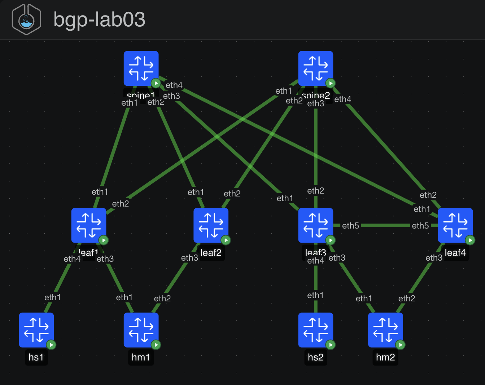

# BGP Lab 03: EVPN Multihoming (ESI-LAG) vs MLAG

**Level:** CCIE DC | **Stack:** containerlab 0.79.0, cEOS 4.36.0.1F, wbitt/network-multitool:alpine-extra

One fabric, two redundancy designs, running at the same time so you can watch them behave differently under the same failure. The left pair uses EVPN multihoming: standards-based, no peer link, each leaf keeps its own VTEP. The right pair uses MLAG: a vendor mechanism that makes two switches pretend to be one, with a peer link and a shared VTEP IP. Both present a single LACP bundle to a Linux host running a real 802.3ad bond.

You will see type-1, type-2 and type-4 routes doing their actual jobs: DF election deciding who floods BIUM, aliasing load-balancing unicast to a MAC learned on only one leaf, and mass withdraw pulling an entire segment with one update.

## Topology



```
                  +-----------+                +-----------+
                  |  spine1   |                |  spine2   |     AS 65100
                  +-----------+                +-----------+
                     E1..E4                       E1..E4
                        |   every leaf: eth1 -> spine1, eth2 -> spine2   |
      +-----------+-----+-----------+        +-----------+-----+--------+
      |                             |        |                          |
 +---------+   +---------+     +---------+        +---------+
 |  leaf1  |   |  leaf2  |     |  leaf3  | E5--E5 |  leaf4  |
 |  65101  |   |  65102  |     |  65134  |  peer  |  65134  |
 |VTEP .11 |   |VTEP .12 |     |VTEP .34 |  link  |VTEP .34 |
 +---------+   +---------+     +---------+        +---------+
   E3 |  | E4      | E3          E3 |  | E4          | E3
      |  hs1       |                |  hs2           |
      |  orphan    |                |  orphan        |
      +-----+------+                +-------+--------+
            |  Po1, ESI 0011:1111:...       |  Po2, mlag 2
          +-----+                         +-----+
          | hm1 |  bond0 802.3ad          | hm2 |  bond0 802.3ad
          +-----+  10.10.10.101           +-----+  10.10.10.102

    EVPN MULTIHOMING                     MLAG
    unique ASNs                          shared ASN 65134
    one VTEP per leaf                    one shared VTEP IP
    no peer link                         peer link Po1000, VLAN 4094
    DF election via type-4               primary/secondary via MLAG protocol
    aliasing via type-1 per-EVI          the pair is invisible to the fabric
```

## Addressing

| Item | Value |
|---|---|
| Spines | AS 65100, Lo0 10.0.0.1-2 |
| ES pair | leaf1 AS 65101 Lo0 10.0.0.11 VTEP 10.0.1.11, leaf2 AS 65102 Lo0 10.0.0.12 VTEP 10.0.1.12 |
| MLAG pair | leaf3 and leaf4 both AS 65134, Lo0 10.0.0.13/.14, **shared** VTEP 10.0.1.34 |
| Underlay P2P | 10.1.*spine*.x/31, spine even, leaf odd |
| MLAG peer | VLAN 4094, 10.255.34.0/31 (leaf3 .0, leaf4 .1), Port-Channel1000 |
| ESI | 0011:1111:1111:1111:1111, ES-import RT 00:11:11:11:11:11, LACP system-id 0011.1111.1111 |

| VLAN | Subnet | L2VNI | Hosts |
|---|---|---|---|
| 10 APP | 10.10.10.0/24 | 10010 | hm1 .101 (ESI-LAG), hm2 .102 (MLAG), hs1 .103 (orphan on leaf1) |
| 20 DB | 10.10.20.0/24 | 10020 | hs2 .104 (orphan on leaf3) |

VRF RED, L3VNI 50001, anycast gateway MAC 00:1c:73:00:00:99.

## Host prerequisite

The Linux bonds in hm1 and hm2 need the bonding module in your host kernel:

```bash
sudo modprobe bonding
```

`./lab.sh deploy` checks for it and offers to load it. Without it both dual-homed hosts come up with no bond0 and every multihoming test fails for a reason that has nothing to do with the fabric.

## Quick start

```bash
chmod +x lab.sh
./lab.sh deploy base        # Part A: build ESI-LAG and MLAG yourself
./lab.sh deploy solution    # full reference
./lab.sh verify             # fabric, bonds, ES/MLAG state, aliasing, data plane
./lab.sh compare            # ESI-LAG and MLAG state printed side by side
./lab.sh converge hm1       # measure loss when leaf1 loses its host link
./lab.sh converge hm2       # same test on the MLAG side
./lab.sh fail leaf2         # shut a host-facing link by hand
./lab.sh break random       # solution only
./lab.sh cli leaf1          # Cli | hm1,hm2,hs1,hs2 -> sh
./lab.sh destroy
```

RAM: 6 cEOS plus 4 Linux containers, roughly 10 to 12 GB.

## Files

```
bgp-lab03.clab.yml     topology (includes the host bond setup)
lab.sh                 deploy | verify | compare | fail | converge | break | restore
configs/base/          fabric + EVPN + orphan ports; Port-Channels exist but are bare
configs/solution/      full ESI-LAG and MLAG reference
tools/gen_configs.py   one data model, both modes
docs/TASKS.md          Part A build, Part B behavior, Part C tickets, Part D design
docs/TICKETS.md        symptoms only
docs/SOLUTIONS.md      spoilers
```

## Caveats

- cEOS LACP, MLAG and EVPN MH all run in software. Convergence numbers show you the *shape* of the difference between the two designs, not hardware timings.
- `show evpn ethernet-segment` output format shifts between EOS releases. If a `verify` assertion looks wrong but the state is fine, check the raw output with `./lab.sh compare` and adjust the grep in `lab.sh`.
- EVPN MH on cEOS is single-active or all-active depending on release defaults. Confirm with `show evpn ethernet-segment detail` rather than assuming.
- Lab 01 and 02 shipped with silent-failure bootstraps. There is no SONiC node here, so that class of problem does not apply, but the same rule holds: if a check passes suspiciously fast, read the raw command before trusting it.

## Lab series

| Lab | Focus |
|---|---|
| 01 | eBGP Clos, EVPN L2/L3VNI, symmetric IRB, VRF-lite border, fusion routing |
| 02 | Dual-ISP edge: local-pref, MED, prepend, communities, RTBH, BFD |
| 03 | EVPN multihoming vs MLAG (this lab) |
| 04 | iBGP overlay with route reflectors, unnumbered underlay, add-path |
| 05 | Inter-VRF route leaking inside EVPN vs centralized fusion |
| 06 | Multi-site DCI: EVPN gateway, type-5 re-origination, domain path |
| 07 | SONiC as an EVPN leaf in a mixed Arista/SONiC fabric |
| 08 | Convergence engineering: BFD, timers, graceful restart, maintenance mode |
| 09 | BGP security and scale: max-prefix, GTSM, RPKI concepts, policy frameworks |
