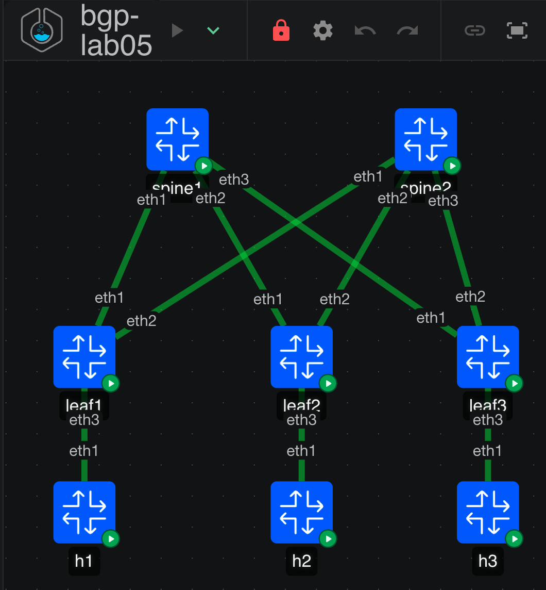

# BGP Lab 05: Unnumbered eBGP Underlay (RFC 8950)

**Level:** CCIE DC | **Stack:** containerlab 0.79.0, cEOS 4.36.0.1F (every node)

Six fabric links with no IPv4 address on any of them. eBGP sessions form over IPv6 link-local, discovered by neighbor discovery rather than configured, and they carry the IPv4 loopbacks with IPv6 next hops. VXLAN then tunnels between IPv4 VTEPs over routes whose next hop is an `fe80::` address.

The lab ships the **same fabric built both ways** so you can diff them. That matters because the selling point of unnumbered is not elegance, it is that every leaf config becomes identical except for its hostname, loopbacks and ASN. `./lab.sh diff` proves or disproves that claim in one command.

This is the lab that was originally folded into Lab 04. It did not fit there: an unnumbered RFC 8950 underlay needs a unique ASN per device so the link-local sessions are eBGP, while Lab 04 needs one ASN everywhere so its overlay is iBGP. You cannot have both on the same box.

## Topology



```
                   +-----------+              +-----------+
                   |  spine1   |              |  spine2   |    AS 65100 (shared)
                   | 10.0.0.1  |              | 10.0.0.2  |
                   +-----------+              +-----------+
                     E1 E2 E3                   E1 E2 E3
                      |  |  |                    |  |  |
          +-----------+  |  +--------+    +------+  |  +--------+
          |   +----------+-----------|----|---------+           |
          |   |                      |    |                     |
    +-----------+            +-----------+            +-----------+
    |   leaf1   |            |   leaf2   |            |   leaf3   |
    |   65101   |            |   65102   |            |   65103   |
    | Lo0 .0.11 |            | Lo0 .0.12 |            | Lo0 .0.13 |
    | Lo1 .1.11 |            | Lo1 .1.12 |            | Lo1 .1.13 |
    +-----------+            +-----------+            +-----------+
          E3                       E3                       E3
          h1                       h2                       h3
      v10 .101                 v10 .102                 v20 .103

  every leaf: Ethernet1 -> spine1, Ethernet2 -> spine2

  UNNUMBERED MODE                        NUMBERED MODE (the control)
  no IPv4 on E1/E2, ipv6 enable          /31 per link, 10.1.<spine>.x
  neighbor interface Et1-2 ...           neighbor <ip> remote-as ...
  IPv4 loopbacks, fe80:: next hops       IPv4 loopbacks, IPv4 next hops
  ONE underlay line per leaf             six lines per leaf, all different

  EVPN overlay: identical in both modes. Loopback0 to Loopback0, eBGP
  multihop, spines with next-hop-unchanged. It never touches a fabric link.
```

## Addressing

| Item | Value |
|---|---|
| Spine ASN | 65100, shared by both spines |
| Leaf ASNs | leaf1 65101, leaf2 65102, leaf3 65103 |
| Lo0 (router-id, overlay peering) | spines 10.0.0.1-2, leaves 10.0.0.11-13 |
| Lo1 (VTEP) | 10.0.1.11, .12, .13 |
| Fabric links, unnumbered mode | **none.** `ipv6 enable` only, link-local addresses are auto-generated |
| Fabric links, numbered mode | 10.1.*spine*.x/31, spine even, leaf odd |

| VLAN | Subnet | L2VNI | Hosts |
|---|---|---|---|
| 10 APP | 10.10.10.0/24 | 10010 | h1 .101 (leaf1), h2 .102 (leaf2) |
| 20 DB | 10.10.20.0/24 | 10020 | h3 .103 (leaf3) |

VRF RED, L3VNI 50001, RT 50001:50001, anycast gateway MAC 00:1c:73:00:00:99.

## The four commands that make unnumbered work on EOS

All four are in the `unnumbered` configs. Three of them are easy to forget and produce different failures.

| Command | Where | What happens without it |
|---|---|---|
| `ipv6 unicast-routing` | global | EOS never looks for a link-local neighbor. No session forms at all, and nothing explains why. |
| `ipv6 enable` | each fabric interface | No link-local address on that link, so no neighbor to find. |
| `neighbor interface Et1-2 peer-group UNDERLAY remote-as 65100` | `router bgp` | There is no session. Note that an interface neighbor **must** be bound to a peer group; EOS rejects it otherwise. |
| `neighbor UNDERLAY next-hop address-family ipv6 originate` | `address-family ipv4` | Sessions come up and look healthy, and IPv4 prefixes either never get advertised or arrive with an unusable next hop. |

One more, which is the piece most likely to bite you on hardware:

```
ip routing ipv6 interfaces
```

This is the forwarding-side knob for sending IPv4 traffic out an interface that has no IPv4 address. It is in the configs. Operators peering EOS with Cumulus have reported a spine blackhole without it: routes present, pings failing, including to a directly connected loopback. On virtual platforms it is sometimes a no-op. If this lab's control plane is perfect and forwarding is dead, that command is the first thing to check.

EOS has no `remote-as external`, so every interface neighbor names its ASN explicitly. That creates a useful asymmetry worth noticing: a leaf collapses to one underlay line because both uplinks face the same spine ASN, while a spine needs one line per leaf. Unnumbered gives you maximum uniformity exactly where you have the most devices.

## Modes

| Mode | What is configured | Use |
|---|---|---|
| `base` | IPv6 enabled on fabric links, VLANs, SVIs, VRF, VXLAN. **No BGP.** | Part A: build underlay and overlay |
| `numbered` | Classic /31 eBGP underlay plus the EVPN overlay. Fully working. | The control. Deploy it first if unnumbered misbehaves, so you can tell a lab problem from a platform problem. |
| `unnumbered` | Same fabric, underlay converted to interface-based eBGP with RFC 8950 | The reference, and the baseline for the 8 tickets |

## Quick start

```bash
chmod +x lab.sh
./lab.sh deploy unnumbered   # one mode per deploy: base, numbered or unnumbered
./lab.sh verify              # IPv6 plumbing, RFC 8950 next hops, overlay, data plane
./lab.sh nexthops            # the full IPv4-over-IPv6-next-hop chain, five steps
./lab.sh diff leaf           # how little differs between two leaves
./lab.sh diff modes          # numbered vs unnumbered, per device
./lab.sh break random        # unnumbered baseline; then ./lab.sh reveal or restore
./lab.sh cli leaf1
./lab.sh destroy
```

RAM: 8 cEOS nodes, roughly 11 to 13 GB. Boot plus convergence takes 3 to 4 minutes.

## Files

```
bgp-lab05.clab.yml     topology
lab.sh                 deploy | verify | nexthops | diff | break | restore | cli
configs/base|numbered|unnumbered/   rendered configs
tools/gen_configs.py   one data model, all three modes
docs/TASKS.md          Part A build, Part B mechanics, Part C tickets, Part D design
docs/TICKETS.md        symptoms only
docs/SOLUTIONS.md      spoilers
```

## Caveats

- **`ip routing ipv6 interfaces` is the known risk.** See above. If forwarding fails while the control plane looks perfect, start there, then deploy `numbered` to confirm the rest of the fabric is sound.
- **EVPN over an unnumbered underlay is less travelled than the numbered path on EOS.** The overlay here peers on loopbacks, which keeps the EVPN next hop an IPv4 VTEP address and sidesteps the harder question. Part D asks what it would take to run EVPN on the interface sessions themselves, which is the Cumulus and FRR pattern; treat that as a research task, not a shipped config.
- The syntax in this lab was taken from current EOS documentation and a write-up tested on cEOS 4.31.2F, not from a run on 4.36.0.1F. Confirm with `neighbor interface ?` and `next-hop address-family ?` on your build before concluding the lab is wrong.
- cEOS forwards in software.

## Sources for the unnumbered syntax

- [Interface eBGP sessions on Arista EOS, ipSpace.net](https://blog.ipspace.net/2024/03/arista-interface-ebgp/) — the config walkthrough, plus the `ip routing ipv6 interfaces` reports in the comments
- [EOS 4.36.2F Border Gateway Protocol (BGP), Arista](https://www.arista.com/en/um-eos/eos-border-gateway-protocol-bgp)
- [BGP IPv6 Link Local Peers Discovery, Arista Community](https://arista.my.site.com/AristaCommunity/s/article/bgp-ipv6-link-local-peers-discovery)

## Lab series

| Lab | Focus |
|---|---|
| 01 | eBGP Clos, EVPN L2/L3VNI, symmetric IRB, VRF-lite border, fusion routing |
| 02 | Dual-ISP edge: local-pref, MED, prepend, communities, RTBH, BFD |
| 03 | EVPN multihoming (ESI-LAG) vs MLAG |
| 04 | iBGP overlay, spine route reflectors, add-path, OSPF underlay |
| 05 | Unnumbered eBGP underlay, RFC 8950, IPv6 link-local peering (this lab) |
| 06 | Inter-VRF route leaking inside EVPN vs centralized fusion |
| 07 | Multi-site DCI: EVPN gateway, type-5 re-origination, domain path |
| 08 | SONiC as an EVPN leaf in a mixed Arista/SONiC fabric |
| 09 | Convergence engineering: BFD, timers, graceful restart, maintenance mode |
| 10 | BGP security and scale: max-prefix, GTSM, RPKI concepts, policy frameworks |
